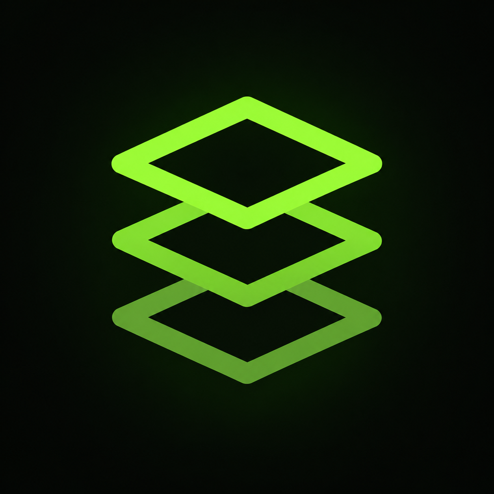

<div align="center">
  
  <h1>GameStack</h1>
  <p><strong>Discover. Collect. Play.</strong></p>
  <p>A personal video game tracker built with Flutter.</p>
  <p>
    
    
    
    
  </p>
</div>

---

## About

GameStack is a mobile game library that helps you keep your gaming life organized. Discover games, save them to your personal collection, and track what you have played, what you are currently playing, and what you want to play next.

## Features

- **Personal game library** — keep your games together in one collection.
- **Play-status tracking** — organize titles as Played, Currently Playing, or Wishlist.
- **Game discovery** — search and browse games using the RAWG catalogue.
- **Genre filtering** — browse Horror titles or exclude them with the available discovery filters.
- **Game details** — view available descriptions, release dates, genres, and cover artwork.
- **Personal ratings** — save your own rating for a game.
- **Account and profile** — sign in with email or Google, manage your nickname, and upload a profile picture.
- **Cloud sync** — store your profile and game collection in Supabase.
- **Steam fallback** — when RAWG is unavailable, discovery can fall back to the Steam store catalogue. Steam fallback results are PC games.

## Tech stack

| Technology | Purpose |
| --- | --- |
| [Flutter](https://flutter.dev/) | Cross-platform UI framework |
| [Dart](https://dart.dev/) | Application language |
| [Supabase](https://supabase.com/) | Authentication, database, and avatar storage |
| [RAWG](https://rawg.io/apidocs) | Game catalogue and discovery data |
| [Steam Store API](https://store.steampowered.com/) | Discovery fallback when RAWG is unavailable |

## Getting started

### Requirements

- Flutter **3.27 or newer**
- Dart **3.6 or newer** (included with Flutter)
- Android Studio or Android SDK tooling
- A Supabase project
- A RAWG API key

### 1. Clone the repository

```bash
git clone https://github.com/YOUR_USERNAME/GameStack.git
cd GameStack
```

Replace `YOUR_USERNAME` with the GitHub account or organization that hosts the repository.

### 2. Install dependencies

```bash
flutter pub get
```

If the Android platform files need to be generated or refreshed, run the setup script for your operating system:

**Windows (PowerShell):**

```powershell
.\setup.ps1
```

**macOS / Linux:**

```bash
chmod +x setup.sh
./setup.sh
```

### 3. Configure environment variables

Copy `env.example.json` to a new file named `env.json`:

**Windows (PowerShell):**

```powershell
Copy-Item env.example.json env.json
```

**macOS / Linux:**

```bash
cp env.example.json env.json
```

Edit `env.json` and provide your own project credentials:

```json
{
  "SUPABASE_URL": "https://YOUR-PROJECT.supabase.co",
  "SUPABASE_PUBLISHABLE_KEY": "YOUR_SUPABASE_PUBLISHABLE_KEY",
  "RAWG_API_KEY": "YOUR_RAWG_API_KEY"
}
```

Do not commit `env.json`, private API keys, service-role keys, signing keys, or other credentials. The repository's `.gitignore` is configured to exclude local environment and signing files. Use a Supabase **publishable** key in the client app; never put a Supabase secret or service-role key in a mobile application.

### 4. Configure Supabase

In your Supabase project, open **SQL Editor** and run these files in order:

1. `supabase/migrations/001_game_stack.sql`
2. `supabase/migrations/002_avatars_bucket.sql`

Then configure authentication:

- Add `gamestack://auth-callback` to **Authentication → URL Configuration → Redirect URLs**.
- If you enable Google sign-in, enable the Google provider in Supabase and configure its OAuth client credentials.
- Set the Google OAuth redirect URI to `https://YOUR_PROJECT_REF.supabase.co/auth/v1/callback` in your Google Cloud OAuth configuration.

Replace `YOUR_PROJECT_REF` with the reference for your own Supabase project.

### 5. Run the app

```bash
flutter run --release --dart-define-from-file=env.json
```

For a debug session, omit `--release`:

```bash
flutter run --dart-define-from-file=env.json
```

### 6. Build an Android APK

```bash
flutter build apk --release --dart-define-from-file=env.json
```

The APK is generated under `build/app/outputs/flutter-apk/`. Configure Android release signing before distributing a production build.

## Game catalogue fallback

GameStack first requests game data from RAWG. If the direct RAWG request cannot be reached, the app can route requests through the Supabase `rawg_proxy` database function. To use that route, configure the function in your own Supabase project and keep any API key used by the function private.

If RAWG is unavailable, the app can temporarily fall back to the Steam Store catalogue. Steam fallback results represent PC games and may have different metadata from RAWG results.

## Project structure

```text
GameStack/
├── android/                  # Android application and launcher resources
├── assets/                   # Local artwork and Inter font files
├── branding/                 # App icon source and branding resources
├── lib/                      # Flutter application source
│   ├── auth_screens.dart     # Welcome, sign-up, and login screens
│   ├── home_screens.dart     # Library, discovery, and profile screens
│   ├── models.dart           # Game and application models
│   ├── services.dart         # Supabase, RAWG, and collection services
│   ├── steam.dart            # Steam catalogue integration
│   ├── theme.dart            # App theme and design tokens
│   └── widgets.dart          # Shared UI components
├── supabase/                 # Database migrations and Supabase config
├── env.example.json          # Environment configuration template
├── pubspec.yaml              # Flutter dependencies and assets
└── README.md
```

## Quality checks

Run the following before submitting changes:

```bash
dart format .
flutter analyze
flutter test
```

## Security notes

- Keep `env.json` and local environment files out of version control.
- Never commit Supabase service-role or secret keys.
- Never commit Android keystores or signing properties.
- Configure Row Level Security policies when setting up the Supabase database.
- If you add a server-side RAWG proxy, store its API key securely on the server side and do not publish it in SQL files or client code.

## License

No license has been specified yet. Unless a license is added to this repository, all rights remain with the copyright holder and reuse is not automatically permitted.

---

<div align="center">
  <sub>Made with Flutter · GameStack</sub>
</div>
